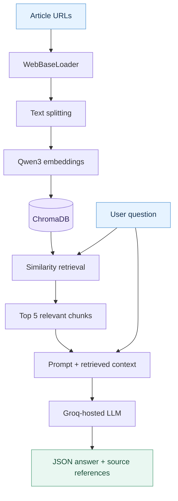
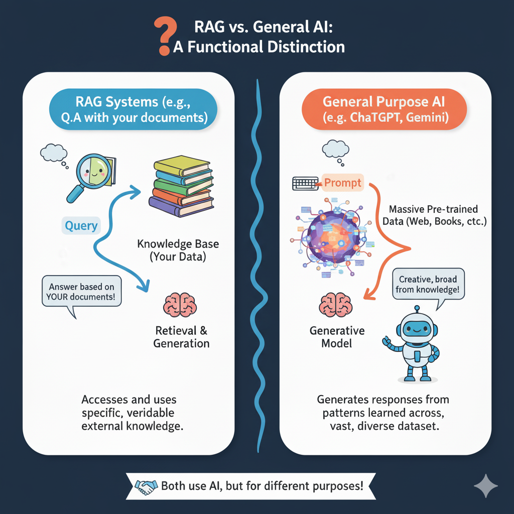

<div align="center">

# 🔎 RAG for Short Articles

https://ragforshortarticles-ui2cz7jjwfmxvd4t5chxbh.streamlit.app/

### Ask questions about articles, backed by the information you provide.

A lightweight **Retrieval-Augmented Generation (RAG)** application that turns article URLs into a searchable knowledge base and uses an LLM to generate context-aware answers with source references.


**[How it works](#-how-it-works)** · **[Tech stack](#-tech-stack)** · **[Run locally](#-run-locally)** · **[Limitations](#-limitations)**

Note: If the app is down, let me know, and I will wake it up

</div>

---

## ✨ Overview

Large language models can answer general questions, but they do not automatically have access to the specific articles we want to analyze. This project explores a simple solution: **retrieve relevant passages first, then use them as context for answer generation**.

Provide **up to three article URLs**, process the content, and ask natural-language questions about what you've shared. The application retrieves relevant text from ChromaDB and sends it to a Groq-hosted LLM along with your question.

**What you can do:**
- 🌐 Load and index content from up to three article URLs.
- 🔍 Search relevant passages using vector similarity.
- 💬 Ask questions in natural language.
- 📚 Receive answers with source references.

## 🧩 How it works



The implementation consists of two stages:

**1. Indexing:** `WebBaseLoader` extracts each page's content. `RecursiveCharacterTextSplitter` splits the documents into overlapping chunks, which are embedded with **Qwen/Qwen3-Embedding-0.6B** and stored in **ChromaDB**.

**2. Question answering:** The user's question is used to retrieve the **five most similar chunks**. LangChain supplies these passages and their source metadata to the **Groq-hosted LLM**, then parses the model's JSON response into an answer and source references.

### RAG vs. general-purpose LLMs

<div align="center">
  
</div>

## 🖥️ Demo

The **Streamlit interface** provides a sidebar for URLs and two tabs: a short RAG explanation and a question-answering interface.

> **Live demo note:** Loading the embedding model and indexing articles can be slow on CPU-limited hosting. Short articles are recommended.

<!-- Optional: add a screenshot after capturing the working application.

-->

## 🛠️ Tech stack

| Layer | Technology | Role |
| --- | --- | --- |
| Interface | Streamlit | URL input and question-answering UI |
| Orchestration | LangChain | Document loading, retrieval and LLM chains |
| Embeddings | Qwen3-Embedding-0.6B via Hugging Face | Vector representation of document chunks |
| Vector store | ChromaDB | Persisted embeddings and similarity retrieval |
| LLM | Groq API | Context-based answer generation |
| Language | Python | Application logic |

**Current retrieval settings:** 500-character chunks · 20-character overlap · Top-5 retrieval · JSON-formatted answers.

## 🚀 Run locally

**1. Clone the repository**

```bash
git clone https://github.com/STorresFranco/RAG_for_short_articles.git
cd RAG_for_short_articles
```

**2. Create a virtual environment and install dependencies**

```bash
python -m venv .venv
pip install -r requirements.txt
```

Activate `.venv` before installing dependencies and launching the app (`.venv\Scripts\activate` on Windows, or `source .venv/bin/activate` on macOS/Linux).

**3. Configure your Groq API key**

The application uses the `GROQ_API_KEY` environment variable. You can create a key in the [Groq Console](https://console.groq.com/).

```bash
# macOS / Linux
export GROQ_API_KEY="your_api_key"
```

```powershell
# Windows PowerShell
$env:GROQ_API_KEY="your_api_key"
```

**4. Start Streamlit**

```bash
streamlit run frontend/streamlit_app.py
```

Enter one to three article URLs in the sidebar, select **Process URLs**, and ask your question in the **App** tab.

> **Configuration:** Model names and retrieval parameters are defined in `backend/rag.py`. Ensure the configured Groq model is currently supported by your account.

## 📁 Project structure

```text
RAG_for_short_articles/
├── backend/
│   ├── rag.py              # Ingestion, embeddings, retrieval and QA
│   ├── template.txt        # Answer-generation prompt
│   ├── log_setup.py        # Logging configuration
│   └── vector_store/       # ChromaDB persistence
├── frontend/
│   ├── streamlit_app.py    # Application UI
│   └── Ragvs.png           # RAG explanatory graphic
├── requirements.txt
└── README.md
```

## ⚠️ Limitations

This is a **learning-oriented prototype**, not a production document-search service.

- **CPU and memory:** Loading the embedding model can be slow on resource-limited hosting.
- **Page extraction:** Some websites block scraping or do not expose article text in easily parsed HTML.
- **Source accuracy:** Source references are generated by the LLM from retrieved metadata; they are not independently verified.
- **Response reliability:** Retrieval quality and LLM output can vary. The JSON parser expects a correctly formatted response.
- **Collection scope:** Processing a new set of URLs resets the existing vector collection.

## 🎯 Why I built it

I developed this project to explore the complete RAG workflow: **from unstructured web content to semantic retrieval and grounded answer generation**. It provides a practical foundation for experimenting with retrieval quality, chunking strategies, source attribution, and more advanced LLM applications.
